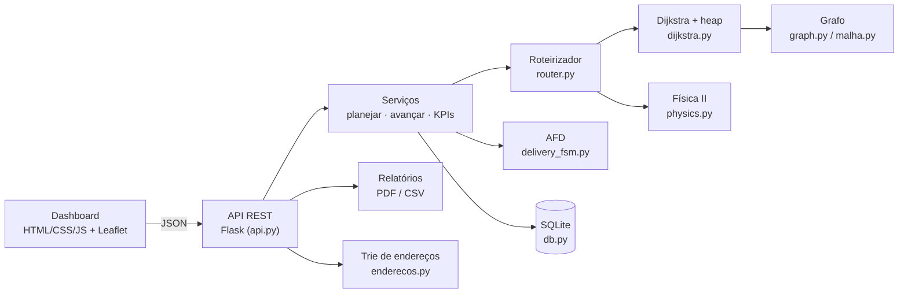
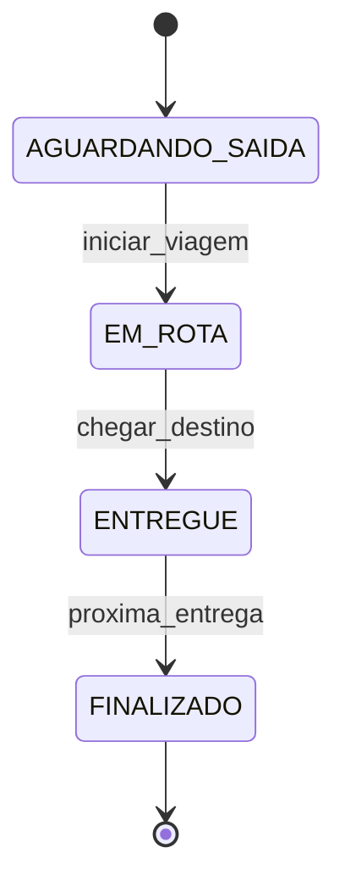

# Arquitetura do SmartRoute Logística

## 1. Visão geral

## 2. Pipeline de roteirização (`router.planejar`)

1. **Decidibilidade** — entregas sem caminho a partir do depósito (vias bloqueadas) ou acima da capacidade
   da frota são marcadas *inviáveis*. O sistema sempre termina e sempre explica o motivo.
2. **Fila de prioridade** — entregas saem por (prioridade, prazo, cadastro).
3. **Atribuição a viagens** — gulosa pelo menor custo marginal de combustível, respeitando capacidade em kg
   e máximo de paradas; fator de equilíbrio evita sobrecarregar um único veículo.
4. **Ordem das paradas** — urgentes primeiro; dentro de cada prioridade, vizinho mais próximo + 2-opt,
   minimizando primeiro atrasos e depois litros, com o custo *real* que depende da carga restante a bordo.
5. **Caminho entre paradas** — Dijkstra com custo físico por aresta (litros), usando a carga naquele instante.
6. **Linha de base empírica** — mesmas entregas por viagem, ordem de cadastro, caminho mais curto em km.

## 3. Modelo físico (seção 5.4 do documento)

Por trecho de comprimento `d`, velocidade `v` e massa total `m = m_veículo + carga`:

| Grandeza | Fórmula |
|---|---|
| Força de atrito | `F_at = μ · m · g` |
| Resistência do ar | `F_ar = ½ · ρ · C_d · A · v²` |
| Potência | `P = F_total · v` |
| Energia do combustível | `E = F_total · d / η` |
| Combustível | `L = k · E / PC`, com `PC` = poder calorífico (kJ/L) e `k` = fator de calibração |

`Custo_rota = Σ (F_total · d) / (η · PC)` — exatamente a fórmula do documento, com o fator `k`
ajustando a escala ao km/L de referência (ver README, premissa 1).

## 4. AFD dos estados da entrega

`Q` = 4 estados · `Σ` = 3 eventos · `q0` = AGUARDANDO_SAIDA · `F` = {FINALIZADO}. Cada estado tem exatamente
uma transição de saída (autômato determinístico e linear). Toda transição é registrada em `historico_estados`
(rastreabilidade). Verificar se uma sequência de eventos é válida é decidível em tempo linear.

## 5. Complexidade

| Operação | Complexidade |
|---|---|
| Dijkstra com heap | `O((V+E) log V)` |
| Merge Sort das entregas | `O(n log n)` |
| Fila de prioridade (push/pop) | `O(log n)` |
| Busca de endereço na Trie | `O(k)` no tamanho do prefixo |
| 2-opt por viagem | `O(p²)` avaliações por passada (p = paradas, ≤ 12) |

## 6. Modelo de negócio (Empreendedorismo e Inovação)

- **Modelo:** SaaS com assinatura mensal por veículo.
- **Proposta de valor:** menos combustível e quilometragem, entregas no prazo, visibilidade em tempo real para o gestor.
- **Mercado:** pequenas e médias empresas de logística e delivery.
- **Plano financeiro (do documento):** investimento inicial R$ 0,00; custo mensal estimado R$ 150,00
  (hospedagem + suporte); preço sugerido R$ 199,00/mês por veículo.
- **Ponto de equilíbrio:** com esses números, a margem por veículo/mês é R$ 49,00 *se o custo de R$ 150,00
  for por veículo*. Se for um custo fixo da plataforma, bastam 1 cliente com 1 veículo para cobrir (199 > 150).
  Vale esclarecer qual é a leitura antes da apresentação.
- **Argumento de venda:** a economia de combustível medida pelo próprio sistema (KPI "Economia vs. rota
  empírica") entra como prova de valor para o cliente.

## 7. Plano de contingência (Gestão de TI)

| Falha | Mitigação |
|---|---|
| Servidor/aplicação fora do ar | Rotas já planejadas ficam salvas no banco; reiniciar o serviço restaura o estado |
| Banco corrompido | Backup do arquivo `smartroute.db` (cópia simples); `POST /api/reset` recria o estado limpo |
| Via bloqueada sem caminho alternativo | Entrega marcada *inviável* com motivo; demais rotas seguem normalmente |
| Mapa (CDN/OSM) indisponível | O sistema continua calculando; só a camada de tiles do mapa some |
